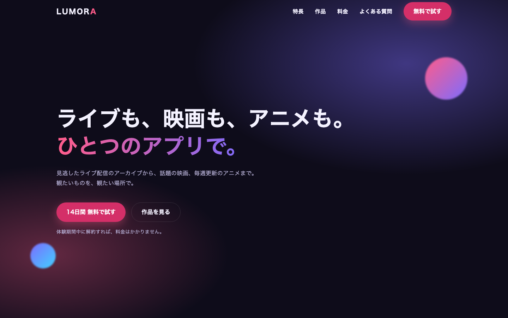

# LUMORA — LP コーディングサンプル

架空のエンタメ配信サービス「LUMORA（ルモラ）」のランディングページです。
HTML / SCSS / JavaScript（ライブラリ不使用）で作りました。実装には Claude Code を使い、構成・レビュー・ブラウザと Lighthouse での確認と修正を自分で行っています。サービス名・作品名・料金はすべて架空です。

| PC | スマートフォン |
|---|---|
|  |  |

## 実装したもの

| 項目 | 内容 |
|---|---|
| レスポンシブ | モバイルファースト。768px / 1024px の2段階で切り替え |
| ハンバーガーメニュー | `aria-expanded` の切り替え、Esc で閉じる、開いている間は背景をスクロールさせない |
| スライダー | 矢印・ドット・スワイプ（Pointer Events）・左右キーに対応。画面幅に応じて1／2／3枚表示。画面外のスライドは `inert` でフォーカス対象から外す |
| 料金の月額／年額切り替え | `aria-pressed` のトグル。金額は `Intl.NumberFormat` で整形 |
| モーダル | フォーカストラップ、Esc・背景クリックで閉じる、閉じたら元のボタンへフォーカスを戻す |
| フォームの入力チェック | Constraint Validation API で必須・メール形式をチェックし、エラーを `aria-live` で読み上げ |
| スクロールで表示 | IntersectionObserver。`prefers-reduced-motion` の環境では動きを止める |
| FAQ | `details` / `summary` のアコーディオン。FAQPage の構造化データ（JSON-LD）付き |

## 表示速度とアクセシビリティ（Lighthouse 12.8.2・2026年10月19日計測）

| | Performance | Accessibility | Best Practices | SEO |
|---|---|---|---|---|
| モバイル | 100 | 100 | 100 | 60 |
| デスクトップ | 100 | 100 | 100 | 60 |

- モバイルの LCP 1.1秒、CLS 0、TBT 0ms
- SEO が60なのは、架空のサービスのページが検索結果に出ないよう `noindex` を入れているためです。SEO のほかの項目はすべて通っています
- 最初の計測で、ピンクのボタンの白文字のコントラスト比が 2.93:1 で基準（4.5:1）を下回っていたため、ボタンの背景色だけを濃くして 4.77:1 にしました
- 画像は使わず、サムネイルは CSS のグラデーション、アイコンはインライン SVG にしています。Web フォントも読み込まず、端末のフォントで表示します

計測結果の全体は `reports/lighthouse-mobile.report.html` / `reports/lighthouse-desktop.report.html` にあります。

## ファイル構成

```
src/
  scss/
    _variables.scss   色・余白・ブレークポイントなどの変数と mixin
    _base.scss        リセット・共通レイアウト・アニメーションの土台
    _components.scss  ヘッダー、スライダー、料金、モーダルなどの部品（BEM）
    style.scss        エントリーポイント
  js/
    main.js           UI の振る舞い（ES Modules）
docs/                 公開用（GitHub Pages）
```

## ビルド

```bash
npm install
npm run build        # SCSS をコンパイルし、JS を docs/ へコピー
node serve.mjs       # http://localhost:8080 で確認
```
